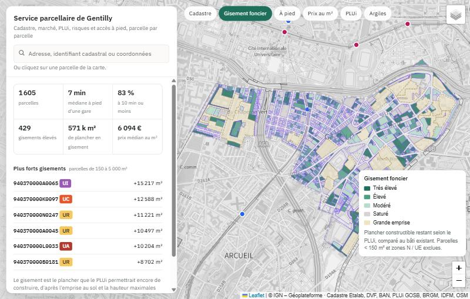
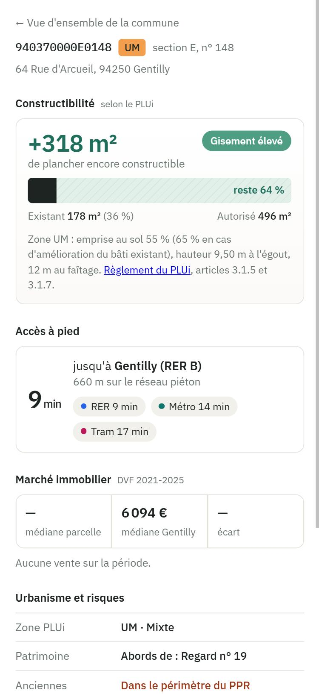
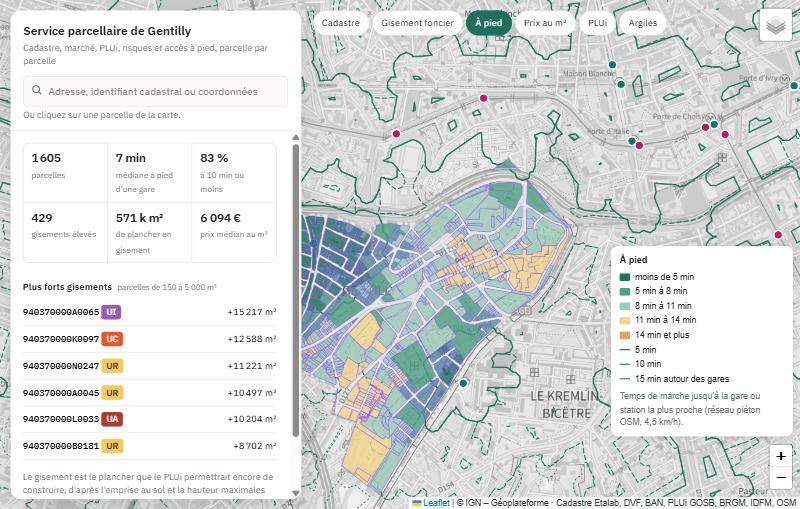

# Service parcellaire PostGIS — Gentilly (94)

Service web spatial qui renvoie la **fiche complète d'une parcelle cadastrale** de Gentilly : potentiel constructible selon le PLUi, temps de marche réel jusqu'aux gares, marché immobilier (DVF), urbanisme, risques, bâti et relief. On l'interroge par adresse, par coordonnées ou par identifiant cadastral.

Tous les calculs sont faits dans **PostgreSQL / PostGIS** (SQL spatial, raster, PL/pgSQL, pgRouting), exposés en API GeoJSON par **pg_featureserv** et affichés dans une carte **Leaflet**.



## Ce que fait le service

| Question | Réponse calculée | Méthode |
|---|---|---|
| Que peut-on encore construire ici ? | Plancher existant, plancher autorisé par le PLUi, gisement restant, classe de gisement | Règles d'emprise et de hauteur extraites du règlement du PLUi, hauteurs des bâtiments BD TOPO |
| À combien de minutes à pied est la gare ? | Temps et distance de marche jusqu'au RER, au métro et au tram | pgRouting (`pgr_drivingDistance` multi-sources) sur le réseau piéton OpenStreetMap |
| Combien vaut le m² ici ? | Prix médian au m² de la parcelle, comparé à la médiane communale, historique des ventes | DVF 2021-2025 agrégées par mutation |
| Quelles règles et quelles contraintes ? | Zone PLUi et répartition, abords de monuments historiques, PPR anciennes carrières, aléa argiles | Intersections avec le zonage du Géoportail de l'Urbanisme, les servitudes et la carte du BRGM |
| Comment est le terrain ? | Surface, bâtiments, emprise bâtie, altitude, pente médiane | Cadastre Etalab, MNT LiDAR HD de l'IGN (raster PostGIS) |

### Un moteur, trois portes

Toute la logique est dans une seule fonction, `gentilly.parcelle_info(id)`. Les trois points d'entrée se contentent de trouver l'identifiant de la parcelle, puis appellent le moteur. La réponse est donc identique quelle que soit la porte utilisée, et un test le vérifie.

```sql
SELECT * FROM gentilly.parcelle_par_id('940370000E0148');
SELECT * FROM gentilly.parcelle_par_coords(2.348437, 48.815313);       -- repli à 15 m sur la voirie
SELECT * FROM gentilly.parcelle_par_adresse('14 pl. Henri-Barbusse');  -- géocodage BAN en base (pg_trgm)
```

<p>


</p>

## Quelques résultats

- **1 605 parcelles** analysées, **429** à gisement élevé ou très élevé, soit environ 571 000 m² de plancher théorique.
- Médiane de **7 min à pied** jusqu'à la gare la plus proche ; 83 % des parcelles sont à 10 min ou moins. L'est de la commune est à 11-14 min de toute station.
- À vol d'oiseau, la gare la plus proche de la mairie est le tram T3a (385 m). À pied, c'est **Gentilly RER B à 9 min**, car le périphérique coupe l'accès au tram.
- Prix médian des logements : **6 094 €/m²** (2021-2025), en baisse de 12 % entre 2022 et 2025.
- Une fiche complète se calcule en **≈ 14 ms**.

Le [rapport technique](rapport/rapport_gentilly_v3.html) détaille la démarche, les choix, les tests et les limites (à télécharger puis ouvrir dans un navigateur).

## Stack

PostgreSQL 17 · PostGIS 3.5 (vecteur et raster) · pgRouting 3.8 · pg_trgm · PL/pgSQL · pg_featureserv 1.3 · Leaflet 1.9 · PyQGIS / GDAL · Python

## Données (toutes ouvertes)

| Donnée | Producteur | Licence |
|---|---|---|
| Parcelles et bâtiments | DGFiP / Etalab (cadastre.data.gouv.fr) | Licence Ouverte 2.0 |
| Demandes de valeurs foncières géolocalisées 2021-2025 | DGFiP / Etalab | Licence Ouverte 2.0 |
| MNT LiDAR HD (1 m) | IGN, Géoplateforme | Licence Ouverte 2.0 |
| Base Adresse Nationale | BAN | Licence Ouverte 2.0 |
| BD TOPO, bâtiments (hauteurs) | IGN, Géoplateforme | Licence Ouverte 2.0 |
| Zonage et règlement du PLUi Grand-Orly Seine Bièvre (16/12/2025) | EPT 12, via le Géoportail de l'Urbanisme | Licence Ouverte 2.0 |
| Servitudes PM1 (PPR) et AC1 (monuments historiques) | Géoportail de l'Urbanisme | Licence Ouverte 2.0 |
| Aléa retrait-gonflement des argiles | BRGM, Géorisques | Licence Ouverte 2.0 |
| Gares et stations | Île-de-France Mobilités | ODbL |
| Réseau piéton | © contributeurs OpenStreetMap | ODbL |

Les URL exactes sont dans [`scripts/telecharger_donnees.py`](scripts/telecharger_donnees.py) et dans le rapport.

## Installation

Prérequis : PostgreSQL avec PostGIS, postgis_raster et pgRouting (fournis par l'installeur PostGIS pour Windows via Stack Builder), QGIS 3.x ou 4.x, Python 3.

1. **Base** : exécuter `sql/01_creation_base.sql`, puis créer dans QGIS une connexion PostGIS nommée `gentilly`.
2. **Données** : `python scripts/telecharger_donnees.py` (≈ 35 Mo, dans `data/`).
3. **Import** : ouvrir `scripts/importer_donnees_qgis.py` dans la console Python de QGIS et l'exécuter.
4. **Traitements SQL**, dans cet ordre :

   | Fichier | Rôle |
   |---|---|
   | `02_dvf_typage_index.sql` | Typage des DVF, index, contraintes du raster MNT |
   | `02b_adresses_pente_mutations.sql` | Adresses BAN, raster de pente, ventes par mutation |
   | `05_v2_donnees.sql` | Zonage PLUi, servitudes, argiles, gares |
   | `07_v3_marche.sql` | Topologie du réseau piéton, temps de marche, isochrones (pgRouting) |
   | `06_v3_potentiel.sql` | Règles du PLUi par zone, potentiel constructible |
   | `03_fonctions.sql` | Moteur `parcelle_info`, géocodeur et les trois portes |
   | `08_couches_api.sql` | Couches d'affichage et rôle `gentilly_api` en lecture seule |
   | `04_tests.sql` | Tests de validation |

   Pour `08_couches_api.sql`, choisir le mot de passe de l'API : `psql -d gentilly -v mdp="'votre_mot_de_passe'" -f sql/08_couches_api.sql`.
5. **API** : télécharger [pg_featureserv pour Windows](https://postgisftw.s3.amazonaws.com/pg_featureserv_latest_windows.zip) et le décompresser dans `pg_featureserv/`. Copier `config/pg_featureserv.toml.example` en `pg_featureserv.toml` et y mettre le mot de passe.
6. **Lancer** : double-cliquer sur `lancer_service.bat`, ce qui ouvre http://localhost:8010.

## Limites

- Le **gisement** est un gabarit théorique (surface × emprise maximale × niveaux), pas une étude de faisabilité. Il ignore les règles de prospect et de pleine terre, les emplacements réservés, les protections patrimoniales et le risque carrières, et raisonne à la parcelle plutôt qu'à l'unité foncière.
- Les **temps de marche** supposent une vitesse constante de 4,5 km/h, sans tenir compte de la pente ni des entrées réelles des stations.
- Le **risque carrières** repose sur l'enveloppe du PPR, pas sur son zonage réglementaire.
- Seules les parcelles ayant connu une vente ont un **prix au m²**.

## Auteur

**Mawa Diaw**, géomaticien et développeur SIG · [LinkedIn](https://www.linkedin.com/in/mawa-diaw)
